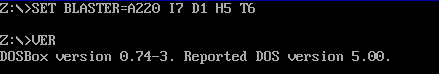
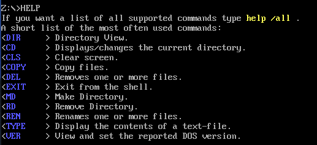
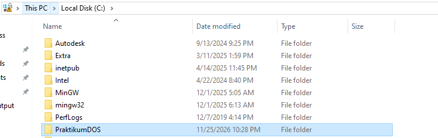
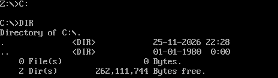
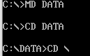
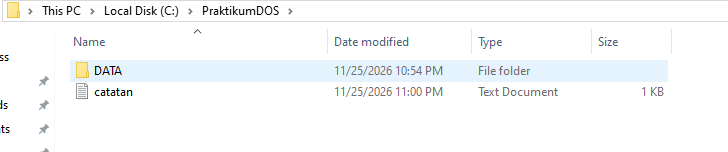
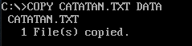
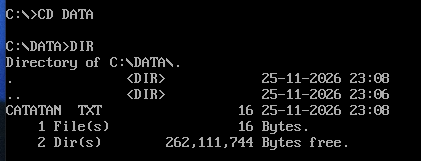
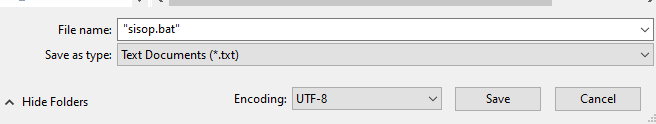
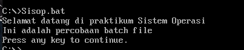

# Modul Praktikum Sistem Operasi

## DOSBox Exploration: Introduction to Operating System Environment and Command Line Interface

### 1. Pendahuluan

Sistem operasi merupakan perangkat lunak yang mengatur kerja komputer dan menjadi penghubung antara pengguna dengan perangkat keras. Salah satu cara untuk mengenal lingkungan sistem operasi adalah dengan menggunakan *command line interface* (CLI), yaitu antarmuka yang memungkinkan pengguna memberikan perintah melalui teks.

Pada praktikum ini, DOSBox digunakan sebagai emulator untuk menjalankan lingkungan DOS. Melalui DOSBox, praktikan akan mempelajari perintah dasar untuk melihat informasi sistem, mengelola direktori dan berkas, serta menjalankan program sederhana. DOSBox bukan sistem operasi, melainkan perangkat lunak yang meniru lingkungan DOS agar dapat digunakan pada komputer modern.

### 2. Tujuan Praktikum

Setelah mengikuti praktikum, praktikan diharapkan mampu:

1. Mengenali lingkungan DOS melalui DOSBox.
2. Menggunakan perintah dasar untuk melihat informasi sistem.
3. Membuat, melihat, menyalin, dan membaca berkas serta direktori.
4. Membuat dan menjalankan program batch sederhana.
5. Memahami penggunaan CLI untuk menyelesaikan tugas sederhana.

### 3. Dasar Teori

#### 3.1 Command Line Interface (CLI)

CLI adalah antarmuka yang digunakan dengan mengetikkan perintah dalam bentuk teks. Setiap perintah memiliki fungsi dan aturan penulisan tertentu. Pengguna perlu mengetikkan perintah dengan benar agar sistem dapat menjalankannya.

#### 3.2 DOS dan DOSBox

DOS (*Disk Operating System*) merupakan sistem operasi yang menggunakan perintah teks untuk mengelola berkas dan menjalankan program. DOSBox adalah emulator yang menyediakan lingkungan DOS di dalam sistem operasi modern.

#### 3.3 Berkas dan Direktori

Berkas (*file*) merupakan tempat penyimpanan data, sedangkan direktori (*directory* atau folder) digunakan untuk mengelompokkan berkas dan direktori lainnya.

#### 3.4 Batch File

Batch file merupakan berkas berekstensi `.BAT` yang berisi kumpulan perintah DOS. Perintah di dalamnya dijalankan secara berurutan oleh penerjemah perintah DOS.

### 4. Alat dan Bahan

1. Laptop atau komputer.
2. Aplikasi DOSBox yang telah terpasang.
3. Aplikasi teks editor, seperti Notepad.
4. Folder khusus untuk menyimpan berkas praktikum.

### 5. Petunjuk Keselamatan dan Pelaksanaan

1. Pastikan DOSBox telah terpasang sebelum praktikum dimulai.
2. Buat folder khusus untuk praktikum agar berkas lebih mudah ditemukan.
3. Sesuaikan lokasi folder pada perintah `MOUNT` dengan lokasi folder di komputer masing-masing.
4. Perhatikan penulisan perintah, nama folder, dan nama berkas.
5. Jika terjadi kesalahan, baca kembali pesan yang muncul dan periksa perintah yang telah dimasukkan.

### 6. Percobaan

#### Percobaan 1 — Exploring DOS Environment

**Tujuan:** Mengenali lingkungan DOS dan melihat informasi dasar melalui perintah CLI.

**Langkah kerja:**

1. Buka aplikasi DOSBox.
2. Perhatikan tampilan awal DOSBox.
3. Ketik perintah berikut, kemudian tekan Enter:

   ```dos
   VER
   ```

   <p align="center">
     
   </p>

4. Amati informasi versi DOS yang ditampilkan.
5. Ketik perintah berikut:

   ```dos
   HELP
   ```

   <p align="center">
     
   </p>

6. Amati daftar perintah yang tersedia.
7. Catat/Screenshot hasil pengamatan, termasuk informasi yang ditampilkan oleh kedua perintah tersebut.

#### Percobaan 2 — File System Management

**Tujuan:** Menggunakan perintah dasar untuk mengelola direktori dan berkas.

**Langkah kerja:**

1. Buat sebuah folder di komputer dengan nama `PraktikumDOS`.

   <p align="center">
     
   </p>

2. Buka DOSBox.
3. Hubungkan folder tersebut ke DOSBox menggunakan perintah berikut. Sesuaikan alamat folder dengan lokasi folder yang dibuat pada komputer masing-masing.

   ```dos
   MOUNT C "C:\PraktikumDOS"
   ```

   <p align="center">
     
   </p>

4. Masuk ke drive C:

   ```dos
   C:
   ```

5. Tampilkan isi direktori:

   ```dos
   DIR
   ```

   <p align="center">
     
   </p>

6. Buat direktori baru dengan nama `DATA`:

   ```dos
   MD DATA
   ```

7. Masuk ke direktori `DATA`:

   ```dos
   CD DATA
   ```

8. Kembali ke direktori utama drive C:

   ```dos
   CD \
   ```

   <p align="center">
     
   </p>

9. Buat sebuah berkas teks bernama `catatan.txt` di luar DOSBox menggunakan Notepad. Isi berkas dengan kalimat sederhana, misalnya `Praktikum Sistem Operasi`.

   <p align="center">
     
   </p>

10. Salin berkas tersebut ke direktori `DATA` menggunakan perintah:

    ```dos
    COPY catatan.txt DATA
    ```

    <p align="center">
      
    </p>

11. Masuk ke direktori `DATA`, lalu tampilkan isi direktori menggunakan `DIR`.

    <p align="center">
      
    </p>

12. Tampilkan isi berkas menggunakan perintah:

    ```dos
    TYPE catatan.txt
    ```

13. Catat/Screenshot fungsi setiap perintah dan hasil yang diperoleh.

#### Percobaan 3 — Command Interpretation and Program Execution

**Tujuan:** Membuat dan menjalankan batch file sederhana.

**Langkah kerja:**

1. Buka Notepad.
2. Ketikkan perintah berikut:

   ```dos
   @ECHO OFF
   ECHO Selamat datang di praktikum Sistem Operasi
   ECHO Ini adalah percobaan batch file
   PAUSE
   ```

3. Simpan berkas dengan nama `sisop.bat` pada folder `PraktikumDOS`. Pastikan tipe berkas disimpan sebagai *All Files* agar ekstensi `.bat` tidak berubah menjadi `.txt`.

   <p align="center">
     
   </p>

4. Buka DOSBox jika belum terbuka.
5. Pastikan folder `PraktikumDOS` sudah terhubung sebagai drive C. Jika belum, jalankan perintah `MOUNT` seperti pada Percobaan 2.
6. Masuk ke drive C dan direktori utama:

   ```dos
   C:
   CD \
   ```

7. Jalankan batch file dengan mengetikkan:

   ```dos
   sisop.bat
   ```

   <p align="center">
     
   </p>

8. Amati keluaran yang ditampilkan.
9. Catat/Screenshot urutan perintah yang dijalankan dan fungsi perintah `ECHO`, `PAUSE`, serta `@ECHO OFF`.

#### Percobaan 4 — Mini Challenge: DOS Command Mission

**Tujuan:** Menerapkan perintah DOS yang telah dipelajari untuk menyelesaikan tugas sederhana.

**Instruksi:**

Kerjakan misi berikut melalui DOSBox. Pastikan sudah berada di drive C dan direktori utama (`C:\`) sebelum memulai.

1. Buat direktori bernama `MISI`.
2. Masuk ke direktori `MISI`.
3. Buat dua direktori di dalamnya, yaitu `DOKUMEN` dan `SALINAN`.
4. Buat berkas teks bernama `misi.txt` menggunakan Notepad. Isi berkas dengan kalimat `Saya berhasil menyelesaikan misi DOS`.
5. Simpan berkas tersebut pada folder `MISI`.
6. Salin `misi.txt` ke dalam direktori `SALINAN`.
7. Ubah nama berkas hasil salinan menjadi `hasil.txt`.
8. Tampilkan isi direktori `SALINAN`.
9. Tampilkan isi berkas `hasil.txt`.
10. Catat/Screenshot perintah yang digunakan untuk menyelesaikan setiap langkah.

### 7. Tugas Modul

Jawablah pertanyaan berikut berdasarkan hasil praktikum.

1. Apa yang dimaksud dengan CLI?
2. Apa perbedaan DOS dengan DOSBox?
3. Apa fungsi perintah `VER` dan `HELP`?
4. Apa fungsi perintah `DIR`, `MD`, dan `CD`?
5. Apa perbedaan perintah `COPY` dan `TYPE`?
6. Apa yang dimaksud dengan batch file?
7. Apa fungsi perintah `ECHO` dan `PAUSE` pada batch file?
8. Mengapa lokasi folder pada perintah `MOUNT` harus disesuaikan dengan lokasi folder di komputer?

### 8. Alokasi Waktu

| Kegiatan | Waktu |
| --- | ---: |
| Percobaan 1 — Exploring DOS Environment | 10 menit |
| Percobaan 2 — File System Management | 15 menit |
| Percobaan 3 — Command Interpretation and Program Execution | 15 menit |
| Percobaan 4 — Mini Challenge | 20 menit |
| **Total** | **60 menit** |
